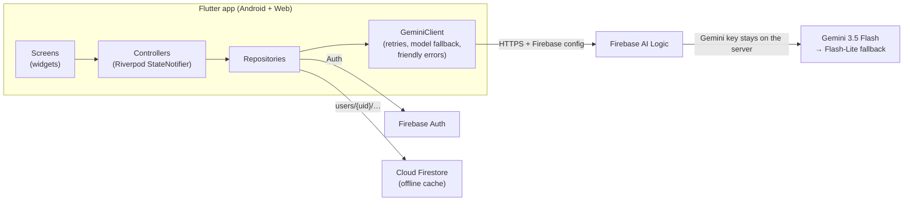

<div align="center">


# PrepPilot

### Your AI career coach: practise interviews out loud, fix your resume, plan your next step.

[](https://flutter.dev)
[](https://dart.dev)
[](https://firebase.google.com)
[](https://ai.google.dev)
[](#-testing)
[](#-getting-started)

**[🌐 Try the live web app](https://aicareercoach-91169.web.app)**

</div>

---

## ✨ What it does

PrepPilot is a Flutter app that helps job seekers get interview-ready. It uses Google Gemini, and every answer is personalised to your target role, experience and skills.

| | Feature | Highlights |
|---|---|---|
| 🎤 | **Mock Interview** | Pick a topic, difficulty and number of questions. Answer each question by **typing or speaking**. A weak answer gets a follow-up question on the weak spot. The final report covers strengths, gaps and what to practise next. |
| 🗣️ | **Voice answers** | Record your answer like a real interview. One AI call transcribes it, scores the content and reviews your **delivery**: filler words, pace and confidence tips. |
| 📄 | **Resume Check** | Upload a PDF. You get an overall score from 5 weighted categories, prioritised fixes and missing keywords, optionally matched to a job description. |
| ✍️ | **Improved CV** | One tap rewrites your resume into a clean, ATS-friendly PDF you can share or print. A **fact-check step** removes anything the AI invented (links, skills, numbers). |
| 💬 | **AI Chat** | A career coach that knows your profile. It replies in Markdown and keeps your chat history. |
| 📊 | **History & stats** | Every interview and resume review is saved, with your average score and best topic. |
| 👤 | **Profile** | Onboarding, target role, experience, skills, light/dark theme, password change and account deletion. |

## 📸 Screenshots

> Add your screenshots to `docs/screenshots/` with these names and they show up here.

| Home | Mock interview (voice) | Answer feedback | Interview report |
|:---:|:---:|:---:|:---:|
|  |  |  |  |

| Resume check | Improved CV | AI chat | Profile |
|:---:|:---:|:---:|:---:|
|  |  |  |  |

## 🏗️ Architecture

Every feature follows the same layers: **Screen → Controller (Riverpod) → Repository → Firebase / Gemini**.



```
lib/
├── core/
│   ├── ai/gemini_client.dart      # one place for model, retries, quota fallback, errors
│   ├── firebase/app_firestore.dart
│   ├── routes/app_routes.dart     # go_router + auth/onboarding redirects
│   ├── theme/                     # light/dark theme
│   └── widgets/                   # logo, snackbars
└── features/
    ├── auth/        # splash, login, sign-up, password reset
    ├── home/        # dashboard + bottom navigation
    ├── chat/        # AI career chat
    ├── interview/   # setup, session (type/voice), feedback, report, history
    ├── resume/      # PDF upload, scoring, improved CV PDF, history
    └── profile/     # onboarding, edit profile, settings
```

Each feature has `data/` (models + repository) and `presentation/` (screens + controller).

## 🧠 Engineering highlights

- **Structured AI output.** Every interview and resume call asks Gemini for JSON that matches a schema, so the app gets typed data (scores, lists, the next question) instead of free text to parse.
- **One call per answer.** Scoring, feedback, the model answer and the next (adaptive) question come from a single request. A full interview costs only *questions + 2* calls, and a voice answer still costs one call.
- **Hallucination guard.** The improved CV is checked against the text of the original resume. Contact details, skills and numbers that weren't in it are removed, and each removal is listed as a tip.
- **No API key in the app.** Gemini is called through **Firebase AI Logic**, so the Gemini key stays on Google's servers. Nothing secret ships in the APK or the website.
- **Quota-aware.** If a model's free daily quota runs out, the client switches to a second model with its own quota. It never retries a quota error, and it tells the user exactly when the limit resets.
- **Fair, consistent scores.** The overall interview score is the app's own average of the answer scores. The resume score is a weighted average the app computes, not a number the AI made up.
- **Cross-platform voice.** Microphone audio is streamed as 16 kHz mono PCM and wrapped into WAV in Dart. It works the same on Android and the web with no temporary files.
- **Robust routing.** The app remembers that a user finished onboarding. A returning user skips login and onboarding and goes straight to Home, even offline.
- **Secure data.** Firestore rules let each user read and write only `users/{their uid}/…`.

## 🛠️ Tech stack

| Area | Choice |
|---|---|
| UI | Flutter 3.32, Material 3, light & dark themes |
| State management | Riverpod 2 (`StateNotifier`, `StreamProvider`, `family`, `autoDispose`) |
| Navigation | go_router with auth and onboarding redirects |
| Backend | Firebase Auth, Cloud Firestore, Firebase Hosting |
| AI | Gemini (3.5 Flash → 3.5 Flash-Lite) via Firebase AI Logic, called with Dio |
| Voice | `record` (PCM stream) → WAV → Gemini audio understanding |
| Files & PDF | `file_selector`, `pdf`, `printing` |
| Rendering | `flutter_markdown` for AI replies |
| Testing | `flutter_test`, fake repositories, widget tests |

## 🚀 Getting started

### Prerequisites
- Flutter **3.32+**
- A Firebase project (the free Spark plan is enough)

### 1. Clone and install
```bash
git clone https://github.com/Honeypanchal/AiCareer_Coach.git
cd AiCareer_Coach
flutter pub get
```

### 2. Connect Firebase
```bash
dart pub global activate flutterfire_cli
flutterfire configure
```
Then in the [Firebase console](https://console.firebase.google.com):
1. **Authentication** → enable **Email/Password**.
2. **Firestore Database** → create a database. The app uses a database named `default`; change `appDatabaseId` in `lib/core/firebase/app_firestore.dart` if yours differs.
3. **AI Logic** → **Get started** → choose **Gemini Developer API**. No API key is needed in the app.

### 3. Deploy the security rules
```bash
firebase deploy --only firestore:rules
```

### 4. Run
```bash
flutter run            # Android
flutter run -d chrome  # Web
```

### Deploy the web app
```bash
flutter build web --release
firebase deploy --only hosting
```

## 🧪 Testing

```bash
flutter analyze   # 0 issues
flutter test      # 61 tests
```

The tests cover:
- Interview flow: follow-ups, skips, retries and voice answers
- Answer and resume parsing, WAV encoding
- Hallucination checks on the improved CV
- Quota fallback and error messages
- Login and onboarding routing, and red error snackbars

Repositories are replaced with fakes, so the tests never call Firebase or Gemini.

## 🔐 Privacy & security

- Resume PDFs and voice recordings go only to Gemini for analysis. **They are never stored.** Only the review, the transcript and the scores are saved.
- Each user's data lives under `users/{uid}`, and the Firestore rules allow access only to the owner.
- No secrets are in the repository or the app bundle.

## 🗺️ Roadmap

- [ ] Firebase App Check (Play Integrity + reCAPTCHA) for AI Logic
- [ ] Progress dashboard: score trends, weak topics, practice streaks
- [ ] Job-description match: tailored interview questions for a specific job post
- [ ] Play Store release
- [ ] CI with GitHub Actions (analyze + test on every push)

## 🎨 Logo

The paper-plane logo is drawn in code: `tool/logo/render_logo_test.dart` renders every PNG in `assets/logo/`. To regenerate the app icons:
```bash
flutter test tool/logo/render_logo_test.dart
dart run flutter_launcher_icons
```

## 👤 Author

**Honey Panchal**: Flutter developer
[GitHub](https://github.com/Honeypanchal)

Built with AI-assisted development (Claude Code). The architecture, prompts, guard-rails and test suite were designed and reviewed by the author.

---

<div align="center">If PrepPilot helped you, consider giving it a ⭐</div>
